GAMELAN WORKFLOW ENGINE - PROJECT STRUCTURE
  =========================================

```mermaid
%% Generated by https://gitdiagram.com/bhangun/gamelan
flowchart TD

subgraph group_clients["Clients"]
  node_cli["Gamelan CLI"]
  node_sdk["Client SDK"]
  node_grpc["gRPC executor service"]
end

subgraph group_workflow["Workflow lifecycle"]
  node_definitions["Workflow definitions"]
  node_definition_service["Definition service"]
  node_runs["Workflow runs<br/>[WorkflowRunId.java]"]
  node_run_manager["Run manager"]
  node_run_repo[("Run repository")]
end

subgraph group_runtime["Execution runtime"]
  node_engine["Workflow execution"]
  node_node_dispatch["Node dispatch"]
  node_dag["DAG scheduling"]
  node_recovery["Run recovery"]
  node_engine_context["Engine context"]
end

subgraph group_extensions["Extensions"]
  node_registry[("Executor registry")]
  node_kafka["Kafka integration"]
  node_plugins["Plugin service"]
  node_agent_context[("Agent context store")]
  node_consul["Consul discovery"]
end

node_user(("Workflow operator"))
node_executor(("Workflow executor"))

node_user -->|"manages workflows"| node_cli
node_user -.->|"uses clients"| node_sdk
node_cli -->|"connects via gRPC"| node_grpc
node_user -->|"creates definitions"| node_definitions
node_definitions -->|"starts runs from"| node_runs
node_user -->|"creates and controls"| node_runs
node_definitions -.->|"managed by"| node_definition_service
node_run_manager -.->|"uses repository"| node_run_repo
node_runs -.->|"executes"| node_engine
node_engine -.->|"dispatches nodes"| node_node_dispatch
node_engine -.->|"schedules DAGs"| node_dag
node_recovery -->|"scans active runs"| node_run_repo
node_engine_context -->|"loads and starts"| node_plugins
node_node_dispatch -->|"dispatches work"| node_executor
node_executor -->|"registers remotely"| node_grpc
node_registry -.->|"selects executors"| node_executor
node_kafka -.->|"notifies status"| node_user
node_consul -.->|"discovers services"| node_registry

click node_cli "https://github.com/bhangun/gamelan/blob/main/ui/gamelan-cli/src/main/java/tech/kayys/gamelan/cli/GrpcClientManager.java"
click node_sdk "https://github.com/bhangun/gamelan/blob/main/framework/gamelan-sdk-client-core/src/main/java/tech/kayys/gamelan/sdk/client/WorkflowRunClient.java"
click node_grpc "https://github.com/bhangun/gamelan/blob/main/runtime/gamelan-runtime-distributed/src/main/java/tech/kayys/gamelan/runtime/grpc/ExecutorServiceImpl.java"
click node_definitions "https://github.com/bhangun/gamelan/blob/main/framework/gamelan-engine-spi/src/main/java/tech/kayys/gamelan/engine/workflow/WorkflowDefinition.java"
click node_definition_service "https://github.com/bhangun/gamelan/blob/main/runtime/gamelan-engine/src/main/java/tech/kayys/gamelan/workflow/WorkflowDefinitionService.java"
click node_runs "https://github.com/bhangun/gamelan/blob/main/framework/gamelan-engine-spi/src/main/java/tech/kayys/gamelan/engine/workflow/WorkflowRunId.java"
click node_run_manager "https://github.com/bhangun/gamelan/blob/main/framework/gamelan-engine-spi/src/main/java/tech/kayys/gamelan/engine/workflow/WorkflowRunManager.java"
click node_run_repo "https://github.com/bhangun/gamelan/blob/main/framework/gamelan-engine-spi/src/main/java/tech/kayys/gamelan/engine/repository/WorkflowRunRepository.java"
click node_engine "https://github.com/bhangun/gamelan/blob/main/runtime/gamelan-engine/src/main/java/tech/kayys/gamelan/workflow/WorkflowExecutionEngine.java"
click node_node_dispatch "https://github.com/bhangun/gamelan/blob/main/framework/gamelan-engine-core/src/main/java/tech/kayys/gamelan/core/execution/DefaultWorkflowEngine.java"
click node_dag "https://github.com/bhangun/gamelan/blob/main/framework/gamelan-dag/src/main/java/tech/kayys/gamelan/dag/DefaultDagSchedulerService.java"
click node_recovery "https://github.com/bhangun/gamelan/blob/main/runtime/gamelan-engine/src/main/java/tech/kayys/gamelan/workflow/WorkflowRecoveryService.java"
click node_engine_context "https://github.com/bhangun/gamelan/blob/main/framework/gamelan-engine-core/src/main/java/tech/kayys/gamelan/core/engine/DefaultEngineContext.java"
click node_registry "https://github.com/bhangun/gamelan/blob/main/runtime/gamelan-executor-registry/src/main/java/tech/kayys/gamelan/registry/ExecutorRegistryService.java"
click node_kafka "https://github.com/bhangun/gamelan/blob/main/runtime/protocol/gamelan-protocol-kafka/src/main/java/tech/kayys/gamelan/kafka/EventProjectionService.java"
click node_plugins "https://github.com/bhangun/gamelan/blob/main/framework/gamelan-plugin-spi/src/main/java/tech/kayys/gamelan/plugin/impl/DefaultPluginService.java"
click node_agent_context "https://github.com/bhangun/gamelan/blob/main/framework/gamelan-engine-core/src/main/java/tech/kayys/gamelan/core/agent/context/FileAgentContextStore.java"
click node_consul "https://github.com/bhangun/gamelan/blob/main/runtime/plugins/gamelan-plugin-consul/src/main/java/tech/kayys/gamelan/plugin/consul/ConsulServiceDiscoveryPlugin.java"

classDef toneNeutral fill:#f8fafc,stroke:#334155,stroke-width:1.5px,color:#0f172a
classDef toneBlue fill:#dbeafe,stroke:#2563eb,stroke-width:1.5px,color:#172554
classDef toneAmber fill:#fef3c7,stroke:#d97706,stroke-width:1.5px,color:#78350f
classDef toneMint fill:#dcfce7,stroke:#16a34a,stroke-width:1.5px,color:#14532d
classDef toneRose fill:#ffe4e6,stroke:#e11d48,stroke-width:1.5px,color:#881337
classDef toneIndigo fill:#e0e7ff,stroke:#4f46e5,stroke-width:1.5px,color:#312e81
classDef toneTeal fill:#ccfbf1,stroke:#0f766e,stroke-width:1.5px,color:#134e4a
class node_cli,node_sdk,node_grpc toneBlue
class node_definitions,node_definition_service,node_runs,node_run_manager,node_run_repo toneAmber
class node_engine,node_node_dispatch,node_dag,node_recovery,node_engine_context toneMint
class node_registry,node_kafka,node_plugins,node_agent_context,node_consul toneRose
class node_user,node_executor toneIndigo
```




  Module Architecture:

  gamelan-parent/
  ├── gamelan-core/                    # Core workflow engine
  │   ├── domain/                    # Domain models & aggregates
  │   ├── engine/                    # Workflow execution engine
  │   ├── state/                     # State management
  │   ├── persistence/               # Event sourcing & snapshots
  │   └── scheduler/                 # Task scheduling
  │
  ├── gamelan-api/                     # REST API layer
  │   ├── resources/                 # JAX-RS endpoints
  │   ├── dto/                       # API data transfer objects
  │   └── validation/                # Request validation
  │
  ├── gamelan-grpc/                    # gRPC service layer
  │   ├── proto/                     # Protocol buffer definitions
  │   ├── services/                  # gRPC service implementations
  │   └── interceptors/              # gRPC interceptors
  │
  ├── gamelan-kafka/                   # Kafka integration
  │   ├── producers/                 # Event producers
  │   ├── consumers/                 # Event consumers
  │   └── serdes/                    # Custom serializers
  │
  ├── gamelan-client-sdk/              # Client SDK
  │   ├── rest/                      # REST client
  │   ├── grpc/                      # gRPC client
  │   └── builder/                   # Fluent API builders
  │
  ├── gamelan-executor-sdk/            # Executor SDK
  │   ├── executor/                  # Executor base classes
  │   ├── grpc/                      # gRPC executor transport
  │   ├── kafka/                     # Kafka executor transport
  │   └── annotations/               # Executor annotations
  │
  ├── gamelan-registry/                # Service registry & discovery
  │   ├── consul/                    # Consul integration
  │   ├── kubernetes/                # K8s service discovery
  │   └── static/                    # Static configuration
  │
  ├── gamelan-cli/                     # Command-line interface
  │   ├── commands/                  # CLI command implementations
  │   └── client/                    # gRPC client utilities
  │
  └── gamelan-integration-tests/       # End-to-end tests

  Technology Stack:
  - Quarkus 3.x (Reactive & Imperative)
  - Hibernate Reactive with Panache
  - SmallRye Mutiny (Reactive programming)
  - PostgreSQL (Primary data store)
  - Redis (Distributed locking & caching)
  - Kafka (Event streaming)
  - gRPC (High-performance RPC)
  - Consul/K8s (Service discovery)
  - OpenTelemetry (Observability)

  Error Codes
  ===========

  Generate the error code docs:

  ```bash
  ./scripts/generate-error-codes.sh
  ```

  Build Profiles
  ==============

  Gamelan uses Gradle profile tasks as the primary build strategy. Built-in
  modules and profiles are defined in Gradle catalog files, while local or
  CI-specific module/profile catalogs can be layered without editing Kotlin
  build logic.

  Gradle profile builder examples:

  ```bash
  # Core engine and SDK only
  ./gradlew gamelanCoreTest

  # Local-first agentic AI / agent orchestration profile
  ./gradlew gamelanAgenticLocalTest

  # Business automation / EIP server profile
  ./gradlew gamelanBusinessAutomationCheck

  # Core plus server app
  ./gradlew gamelanProfileCompile -Pgamelan.profile=core,server

  # Custom profile and lifecycle task
  ./gradlew gamelanProfileRun -Pgamelan.profile=plugins,extensions -Pgamelan.task=check

  # Print available profile definitions
  ./gradlew gamelanProfiles

  # Print included Gradle projects
  ./gradlew gamelanProjects

  # Validate profile catalog files and runtime migration parity
  ./gradlew gamelanValidateProfiles

  # Validate only standalone/distributed Flyway migration parity
  ./gradlew gamelanValidateMigrations
  ```

  See `docs/BUILD_PROFILES.md` for the profile matrix.

  Agent Context Persistence
  =========================

  Gamelan now has a profile/config-driven `AgentContextStore` for local-first
  agent context such as `AGENTS.md`, `SKILL.md`, prompt logs, and thread
  history. Use `gamelan.agent.context.store=file` for local/standalone coding
  agent workflows, or `gamelan.agent.context.store=postgres` for server/cloud
  persistence. See `docs/AGENT_CONTEXT_PERSISTENCE.md`.

  Usage
  =====

  Gradle Usage
  ------------

  Use the Gradle profile builder to work against focused workflow-engine slices:

  ```bash
  # Print profile definitions
  ./gradlew gamelanProfiles

  # Run core engine and SDK tests
  ./gradlew gamelanCoreTest

  # Build client SDK modules
  ./gradlew gamelanClientBuild

  # Check business automation / EIP server modules
  ./gradlew gamelanBusinessAutomationCheck
  ```

  ### Error Codes

  ```bash
  # Show error codes (prints docs if available in repo)
  gamelan error-codes
  ```

  ```bash
  # JSON output (for tooling)
  gamelan error-codes --format json
  ```

  ### Workflow Definition Management

  ```bash
  # Create a workflow definition
  gamelan definitions create -t tenant1 -n "My Workflow" -v "1.0" -d "Description" workflow.json

  # Get a workflow definition
  gamelan definitions get -t tenant1 -s localhost:9090 def123

  # List workflow definitions
  gamelan definitions list -t tenant1 --active-only

  # Update a workflow definition
  gamelan definitions update -t tenant1 def123 -d "New description" --active true

  # Delete a workflow definition
  gamelan definitions delete -t tenant1 def123
  ```

  ### Workflow Run Management

  ```bash
  # Create a workflow run
  gamelan runs create -t tenant1 -d workflow123 -i '{"input": "value"}'

  # Get a workflow run
  gamelan runs get -t tenant1 run123

  # Start a workflow run
  gamelan runs start -t tenant1 run123

  # Suspend a workflow run
  gamelan runs suspend -t tenant1 run123 -r "Maintenance"

  # Resume a workflow run
  gamelan runs resume -t tenant1 run123

  # Cancel a workflow run
  gamelan runs cancel -t tenant1 run123 -r "Cancelled by admin"

  # Send a signal to a workflow run
  gamelan runs signal run123 signalName -p '{"data": "value"}'

  # List workflow runs
  gamelan runs list -t tenant1 -d workflow123 -s RUNNING
  ```

  ### Executor Management

  ```bash
  # Register an executor
  gamelan executors register executor123 -t http-executor -c GRPC -e "http://executor:8080" --max-concurrent 20

  # Unregister an executor
  gamelan executors unregister executor123

  # Send heartbeat from executor
  gamelan executors heartbeat executor123
  ```

  Global Options
  --------------
  - `-s, --server`: gRPC server address (host:port), default: localhost:9090
  - `-h, --help`: Show help information
  - `-V, --version`: Show version information

  Common Use Cases
  ----------------
  1. **Deploy a new workflow**: Use `gamelan definitions create` to register a new workflow definition
  2. **Execute a workflow**: Use `gamelan runs create` followed by `gamelan runs start` to execute a workflow
  3. **Monitor workflow execution**: Use `gamelan runs get` to check the status of a running workflow
  4. **Manage executors**: Use the executors commands to register and manage workflow executors

Testing
=======
Gamelan includes comprehensive testing for all components:

### Unit Tests
- Individual component testing using JUnit 5
- API endpoint testing with REST Assured
- Mock-based testing for isolated functionality

### Integration Tests
- Full application integration tests
- End-to-end workflow execution tests
- Multi-module interaction tests

### Running Tests

```bash
# Run all tests
./mvnw test verify

# Run tests for specific module
./mvnw test -pl <module-name>

# Run integration tests only
./mvnw verify -DskipUTs=true
```

  4. **Manage executors**: Use the executors commands to register and manage workflow executors
